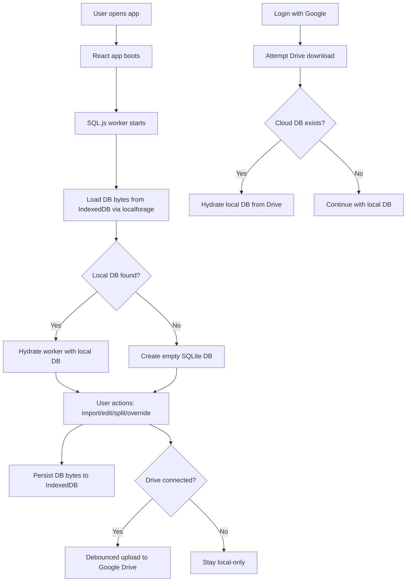

# BetterView Spending Tracker

## Overview
BetterView is now a local-first personal finance tracker.

Your canonical database lives in the browser (SQL.js in a Web Worker), is persisted locally, and is optionally synchronized to Google Drive as a portable SQLite file (`betterview_transactions.db`).

The app is now frontend-only and designed for resilient local usage with optional cloud backup/sync.

## Local-First Architecture

### Core data model
The transactions schema is SQLite-compatible and used across local browser and sync flows:

- `id` (INTEGER PRIMARY KEY AUTOINCREMENT)
- `date` (TEXT, ISO `YYYY-MM-DD`)
- `description` (TEXT)
- `amount` (REAL; expenses are negative)
- `account` (TEXT)
- `category` (TEXT)
- `source_file` (TEXT)
- `manual_override` (INTEGER nullable)
- `dedupe_group_key` (TEXT)
- `dedupe_source_amount` (REAL)
- `dedupe_source_date` (TEXT)
- `split_parent_id` (INTEGER nullable)
- `is_hidden` (INTEGER default `0`)
- `dedupe_seq` (INTEGER; occurrence number of identical rows within one file)
- `import_batch_id` (TEXT; the import that added the row, for undo)
- `applied_rule_id` (INTEGER; the rule that last categorized or split the row)
- `merchant` (TEXT; cleaned merchant name)
- `reimburses_id` (INTEGER; the expense a refund or reimbursement offsets)

Supporting tables: `rules`, `import_batches`, `csv_profiles`, `merchant_rules`, `transaction_tags`, `budgets`, `account_balances`, `app_settings`.

### Runtime flow
1. App starts and initializes SQL.js in `src/workers/sqlWorker.js`.
2. `DatabaseContext` loads previously saved DB bytes from browser storage (`localforage` / IndexedDB).
3. If available, DB bytes are hydrated into the worker and all queries/mutations run locally.
4. CSV imports, edits, split transactions, and overrides are written directly to the local DB.
5. After each mutation, DB bytes are persisted back to browser storage.
6. If Google Drive is connected, auto-sync uploads the DB after a debounce and on tab hide.

### Sync model
- Local copy is always the working copy.
- Drive copy is a backup/sync target.
- On sign-in, the app attempts to download the Drive DB and hydrate local state.
- Sync uses Google Drive `drive.file` scope and updates or creates `betterview_transactions.db`.

### Architecture diagram


## Project Structure
- `src/`, `public/`, and Vite config files at repo root: Primary app (React + Vite + SQL.js worker + Drive sync)
- `initial_transaction_data/`: Local sample/history files (do not commit personal exports)

## Tech Stack
- Frontend: React 19, Vite, TypeScript, Tailwind CSS, Recharts
- Local DB runtime: SQL.js + Web Worker + localforage
- CSV ingest: Papa Parse
- Optional sync: Google OAuth + Google Drive API

## Quick Start

### 1. App (primary local-first app)
From repo root:

```bash
npm install
npm run dev
```

Then open `http://127.0.0.1:9445`.

## CSV Import Behavior
The importer (`src/csvImporter.js`) recognizes Fidelity transaction and history exports. Any other bank's CSV opens a column-mapping step: pick the date, description, amount (or separate debit and credit) and account columns, the date order (month first, day first or year first) and the sign convention, then optionally save it as a named format. Saved formats are matched automatically on later imports.

- Dates are parsed only in explicit formats; ambiguous or unreadable dates are skipped and listed, never guessed.
- Amounts accept `$1,234.56`, `(12.00)`, `12.00-` and `CR`/`DR` suffixes.
- Duplicates are detected on `(date, description, amount)` plus an occurrence number within the file, so two identical coffees on one day both import, while re-importing the same file adds nothing.
- Every import is recorded as a batch: the results panel shows what was added, skipped and changed by rules, and the import can be undone from the results panel or the Data page.

## Running It On Your Tailnet
`npm run dev` listens on localhost only. To use the app from other devices, serve a production build and let Tailscale proxy to it rather than exposing the dev server:

```bash
npm run serve:tailnet          # vite build, then vite preview on 127.0.0.1:9445
tailscale serve --bg --https=8443 http://127.0.0.1:9445
```

Add the resulting `https://<machine>.<tailnet>.ts.net:8443` URL to the OAuth client's authorized JavaScript origins in Google Cloud Console. Vite already allows `*.ts.net` hosts; set `VITE_ALLOWED_HOST` for any other hostname.

## Google Drive Access
- Sign-in requests only the `drive.file` scope, which lets the app see files it created itself and nothing else in your Drive. Keep it that way; widening to the full `drive` scope is never needed.
- The access token lives in `sessionStorage` (this tab only) and lasts about an hour. A few minutes before it ends a banner offers "Stay signed in", and pending edits are uploaded before it expires.
- Before the first sync each day, the Drive copy is saved as `betterview_transactions.YYYY-MM-DD.db`; the newest 14 are kept and can be restored from the Data page.
- If another device changed the Drive copy since this device last synced, syncing pauses and asks whether to keep this device's copy, take the Drive copy, or download this device's copy first.
- Optional encryption (Data page) encrypts the Drive copy with AES-256-GCM using a key derived from your passphrase (PBKDF2, 310,000 rounds). The browser copy stays unencrypted so the app stays fast.

## Development
```bash
npm test          # Vitest suite (CSV parsing, dedupe, splits, rules, budgets, recurring, ...)
npm run lint
npm run build     # type-checks, then builds
```
GitHub Actions runs all three on every push and pull request.

## Data Safety Checklist
This repo handles sensitive financial data. Before pushing:

1. Keep all real CSV exports and SQLite DB files untracked.
2. Verify `.gitignore` still excludes `*.csv`, `*.db`, upload/archive folders, and personal exports.
3. If data files were staged previously, untrack them:
   - `git rm --cached *.csv`
   - `git rm --cached *.db`
   - `git rm --cached -r initial_transaction_data`
4. Validate before push:
   - `git status`
   - `git diff --staged`

## Notes And Current Constraints
- Google OAuth client ID is configured through `.env.local` using `VITE_GOOGLE_OAUTH_CLIENT_ID`.
- Login requires a Google Drive connection before entering the dashboard.
- Browser storage is the source of truth during a session; Drive sync is eventual.
- Every save still writes the whole SQLite file to IndexedDB (overlapping saves are coalesced). An OPFS-backed SQLite build would make writes incremental if the database grows large.
